# ColdTrace Logistics — Microsoft Fabric Portfolio Project

**ColdTrace Logistics** is a fictional cold-chain logistics company — a job-application portfolio project built to demonstrate breadth across Microsoft Fabric. The scenario: a company that needs business-performance and vehicle-telemetry reporting — plus visibility into its own data quality — which naturally leads to two different ingestion patterns feeding the same Fabric Lakehouse.

*For schemas, pipeline mechanics, and a runbook, see [docs/ARCHITECTURE.md](docs/ARCHITECTURE.md). The actual notebook code is in [notebooks/](notebooks/).*

## Architecture at a glance

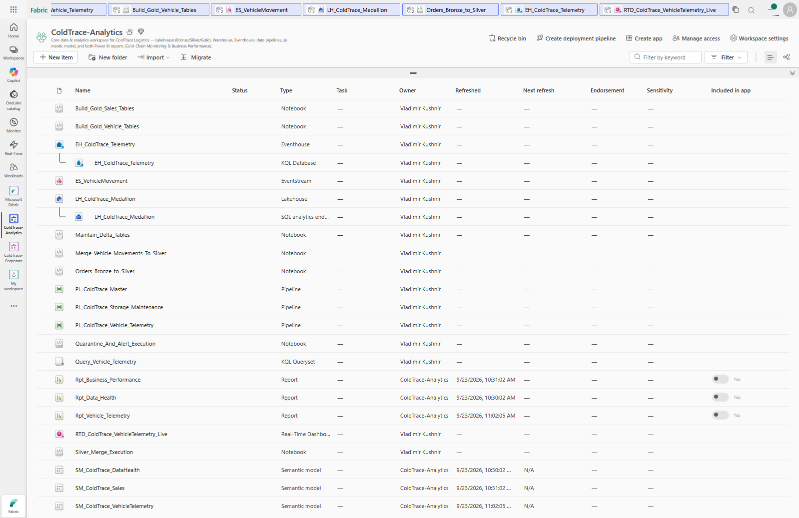
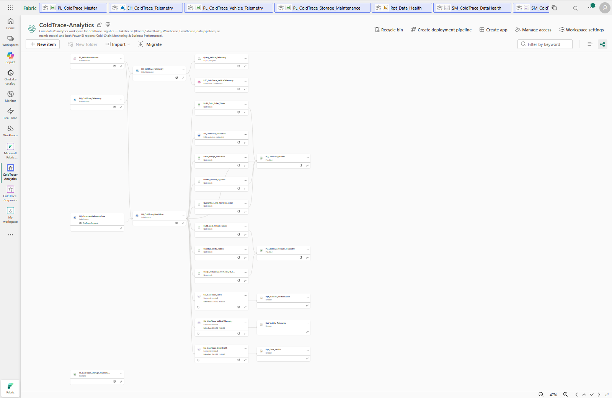

Two ingestion paths, one medallion Lakehouse (Bronze → Silver → Gold), three Direct Lake semantic models feeding three Power BI reports (Business Performance, Data Health, Vehicle Telemetry), plus a KQL-based Real-Time Dashboard on the streaming Hot path. The lineage view traces every dependency end-to-end — from the raw files and the streaming source, through every notebook and table, up to the reports on top.

## 1. Business performance: nightly batch ingestion

Reference data is wired in through a **OneLake Shortcut** straight into Silver — no copying, always current. Transactional order data arrives differently: files land in the Lakehouse's `landing/` folder every night just before midnight. At midnight, a **Copy Data** activity picks them up and writes them into Bronze; `landing/` empties itself, ready for the next night.

From Bronze, [`Orders_Bronze_to_Silver`](notebooks/Orders_Bronze_to_Silver.ipynb) cleanses the data, scores its quality, and stages the result. Rows that pass the gate are merged into `silver_orders` by [`Silver_Merge_Execution`](notebooks/Silver_Merge_Execution.ipynb) — upsert, not overwrite, safe to re-run. (What happens when a file fails the gate is covered under **Data Health** below.)

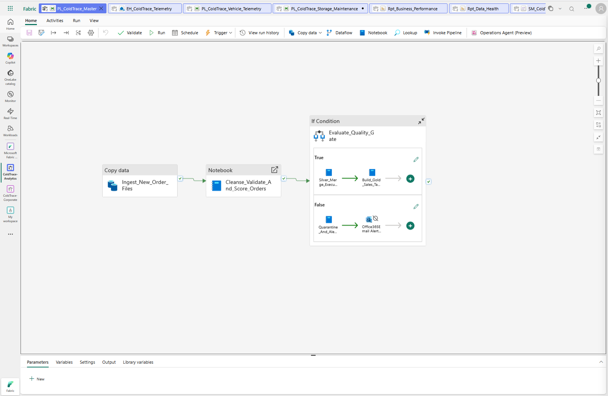

From Silver, [`Build_Gold_Sales_Tables`](notebooks/Build_Gold_Sales_Tables.ipynb) builds Gold: a `Fact_Sales` table plus `Dim_Customer`, `Dim_Product`, and `Dim_Date` in a star schema. The semantic model **SM_ColdTrace_Sales** defines these relationships and carries **Row-Level Security** for four Regional Manager roles, each scoped to their own region. It's the foundation for **Rpt_Business_Performance**.

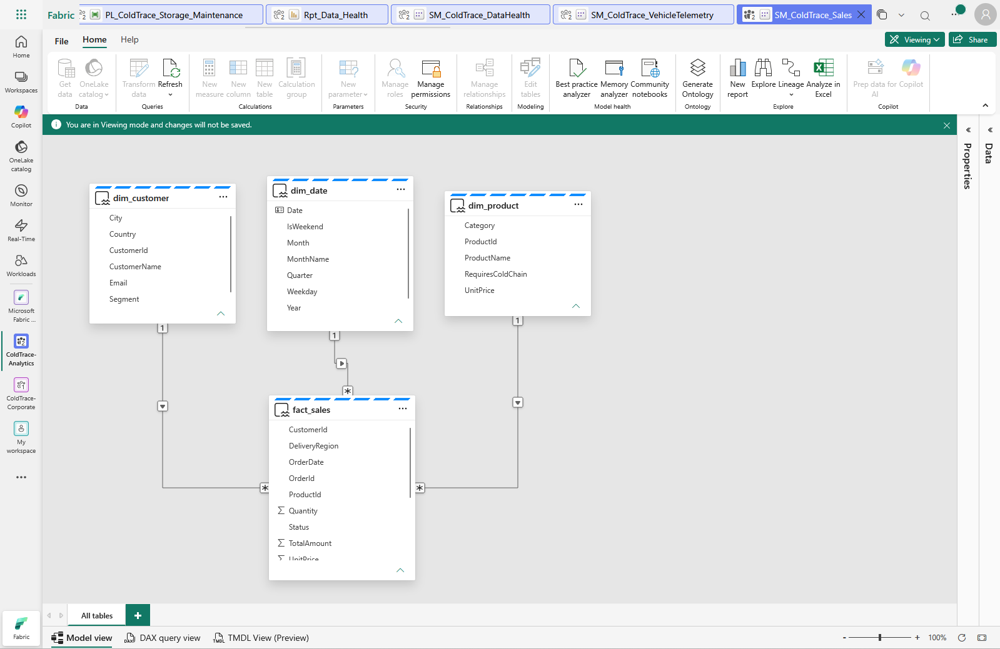
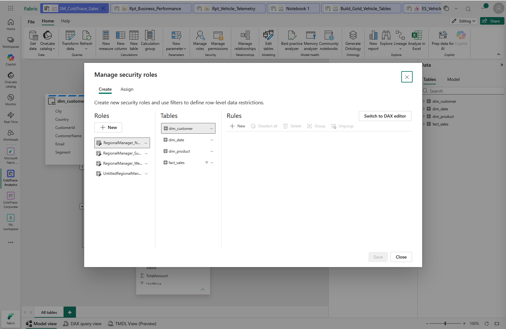
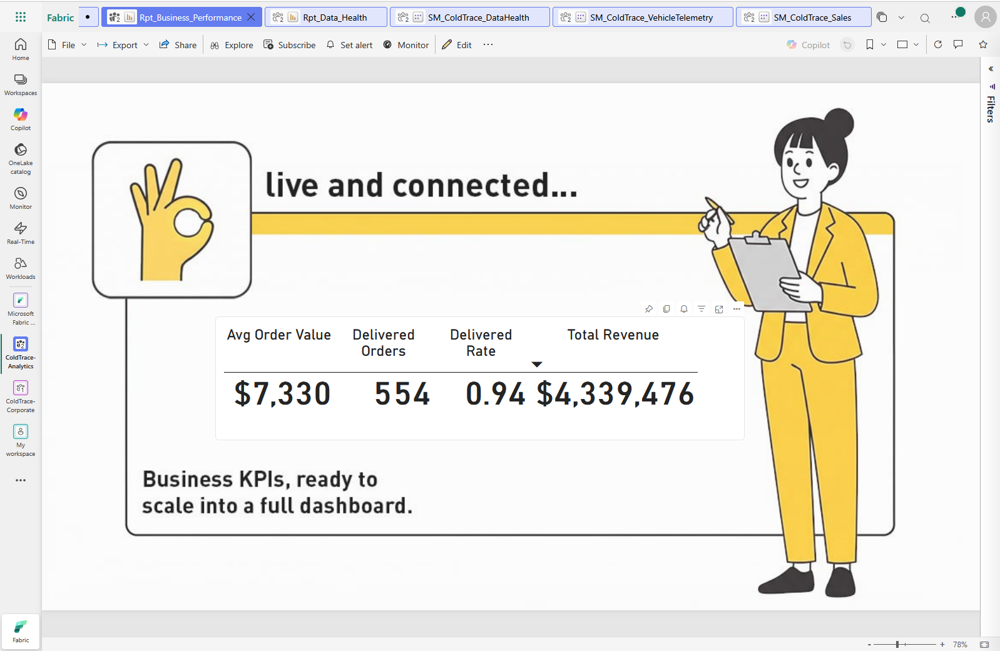

## 2. Data health: monitoring ingestion quality

[`Orders_Bronze_to_Silver`](notebooks/Orders_Bronze_to_Silver.ipynb) doesn't just cleanse the data — it scores every incoming file and stages the full result, valid and invalid rows alike, in `orders_pending_routing`. An **If Condition** then branches on that score:

- **< 70** → [`Quarantine_And_Alert_Execution`](notebooks/Quarantine_And_Alert_Execution.ipynb) quarantines the entire staged file into `quarantine_orders`, and the responsible person is notified by email
- **≥ 70** → [`Silver_Merge_Execution`](notebooks/Silver_Merge_Execution.ipynb) merges the valid rows into `silver_orders`

Either outcome is logged to `silver_pipeline_audit`, regardless of pass or fail. The semantic model **SM_ColdTrace_DataHealth** sits on top of both audit tables, feeding **Rpt_Data_Health** — a continuous view of ingestion quality over time, so a quarantined file doesn't just disappear silently.

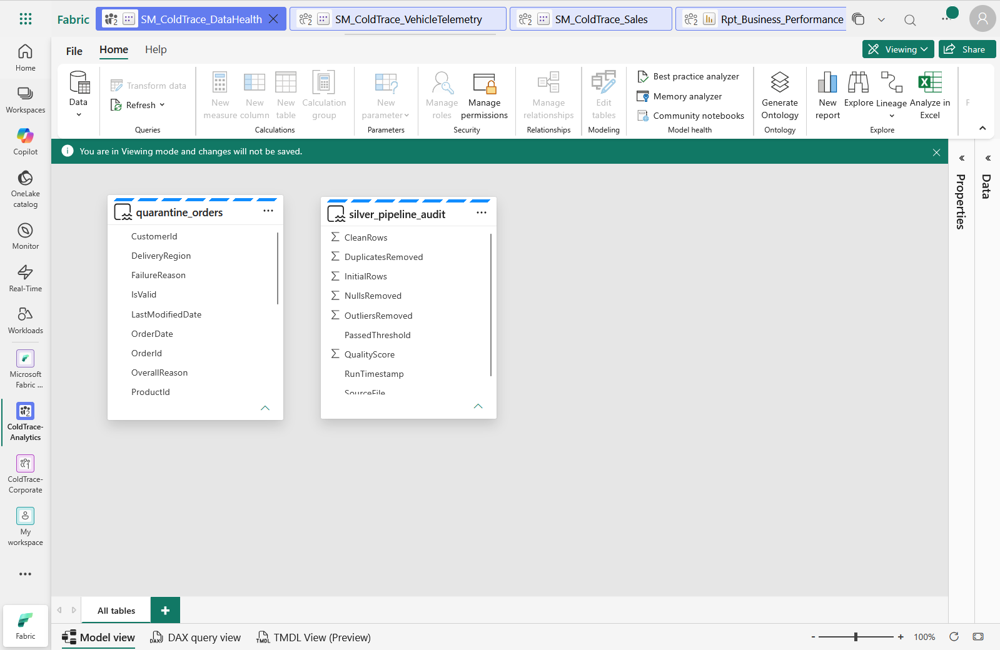
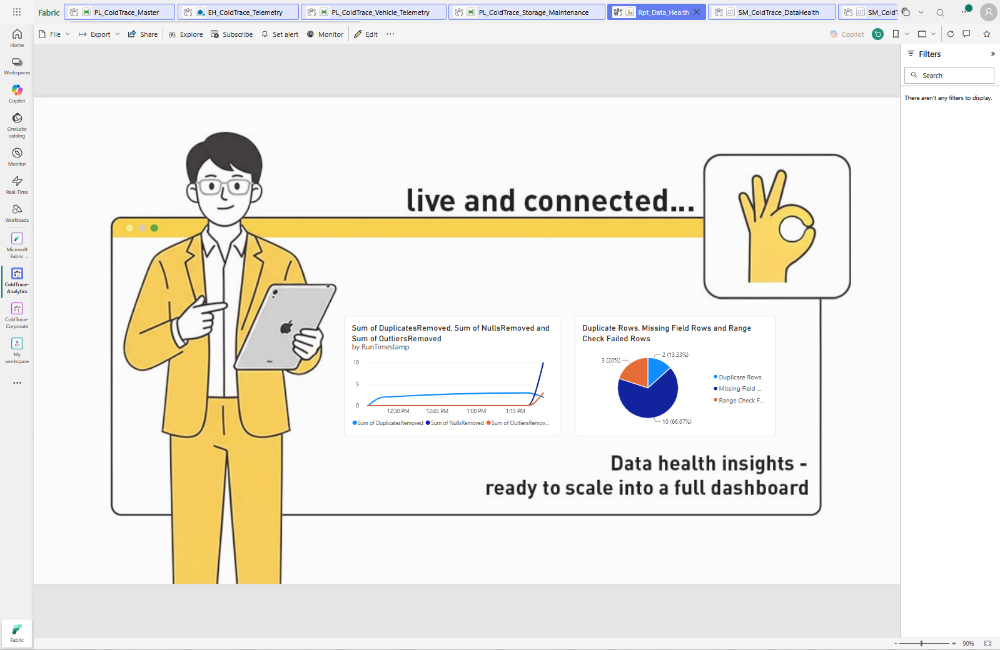

## 3. Vehicle telemetry: streaming ingestion

The second path is a different pattern entirely, using Fabric's own sample bus telemetry data as a stand-in for a live fleet feed. An **Eventstream** ingests it, a **ManageFields** transformation renames columns on the fly, and the stream splits: a **Hot** path into an **Eventhouse** for live monitoring, and a **Cold** path written into the Lakehouse for everything downstream.

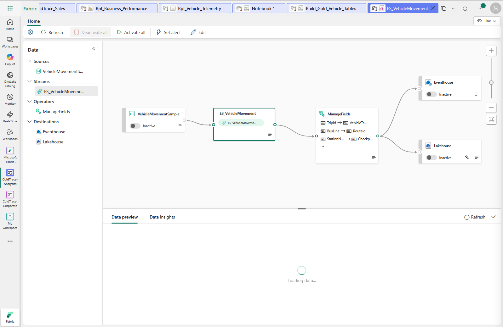

The Hot path isn't just wired up — it's queried. `RTD_ColdTrace_VehicleTelemetry_Live` is a KQL-based **Real-Time Dashboard** (a distinct Fabric artifact type, not Power BI) sitting directly on the Eventhouse: a live event feed, current vehicle-state distribution, and events per route, refreshed straight off the stream.

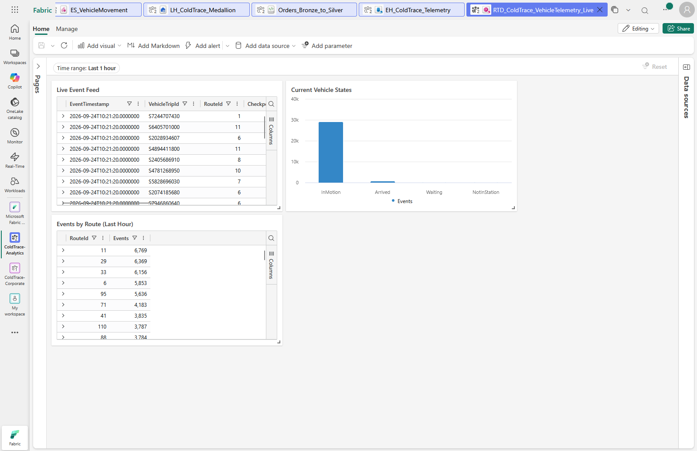

On the Cold path, [`Merge_Vehicle_Movements_To_Silver`](notebooks/Merge_Vehicle_Movements_To_Silver.ipynb) reads new events from `bronze_streaming.vehicle_movements`, parses timestamps, extracts vehicle state, validates mandatory fields, removes duplicates, and merges only unseen events into `silver_vehicle_movements` using a deterministic `MovementId` hash — safe to re-run. [`Build_Gold_Vehicle_Tables`](notebooks/Build_Gold_Vehicle_Tables.ipynb) then rebuilds the Gold star schema: `fact_vehicle_movements` (delay in minutes, delayed/arrival flags) and `dim_route`.

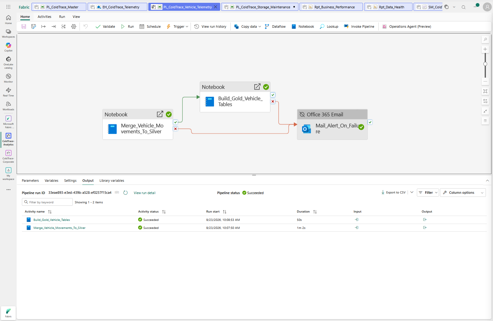

The semantic model **SM_ColdTrace_VehicleTelemetry** links fact and dimension, feeding **Rpt_Vehicle_Telemetry** — arrival patterns, delays, and route-level trends read straight out of a raw event stream.

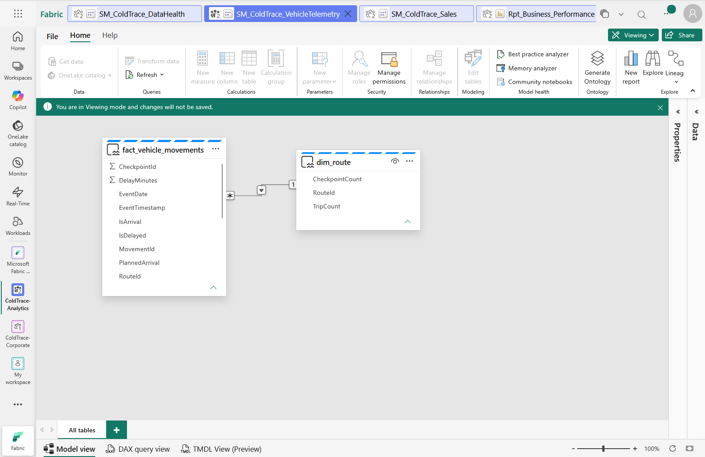
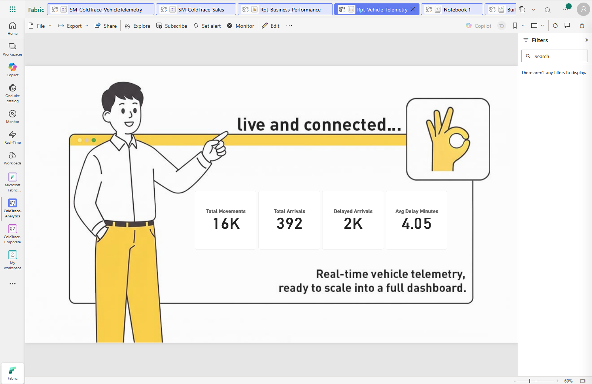

## 4. Keeping it healthy

A separate, weekly pipeline runs [`Maintain_Delta_Tables`](notebooks/Maintain_Delta_Tables.ipynb) — `OPTIMIZE ... ZORDER BY` and `VACUUM` across every Silver and Gold Delta table — deliberately decoupled from the hourly ingestion pipeline so housekeeping doesn't run more often than it needs to.

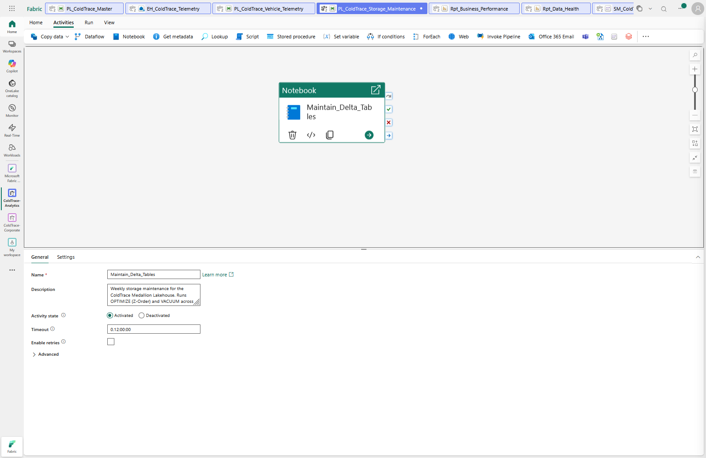

## 5. Design decisions

A few choices worth calling out, since they're the "why" behind the "what":

- **File-level quarantine, not row-level.** If a file fails the quality gate, the whole file goes to quarantine rather than filtering out just the bad rows. Keeps the audit trail unambiguous — a run either fully passed or it didn't.
- **Storage maintenance as its own weekly pipeline**, not chained onto the hourly master pipeline. `OPTIMIZE`/`VACUUM` don't need to run every hour, and `VACUUM`'s 7-day retention lines up exactly with a weekly cadence.
- **RLS defined once, at the semantic model**, not per-report. Any report built on `SM_ColdTrace_Sales` inherits the same regional restriction automatically.
- **Shortcut over copy** for reference data — single source of truth, no duplication, always current, no separate sync job to maintain.
- **Merge over overwrite** for every incremental load — both the order pipeline and the telemetry pipeline are idempotent; re-running a load never creates duplicates.

## 6. What a production rollout would still need

- A paid F-SKU — this runs on a 60-day Fabric trial capacity
- CI/CD for notebooks and pipelines instead of manual promotion between environments
- Broader failure alerting — today only the quality-gate quarantine path sends a notification; a stalled or failed pipeline run doesn't yet
- The trial capacity's Fabric UI doesn't expose "View As" for RLS testing — verified instead by temporarily adding test accounts as workspace members

## 7. Tech stack

Microsoft Fabric — Lakehouse, OneLake Shortcuts, Data Pipelines (Copy Data, Notebook, If Condition, Outlook email), Notebooks (PySpark / Spark SQL), Delta Lake (`MERGE`, `OPTIMIZE`, `VACUUM`, Z-Order), Eventstream, Eventhouse (KQL Database, KQL Queryset), Real-Time Dashboards, Semantic Models (Direct Lake, RLS), Power BI
